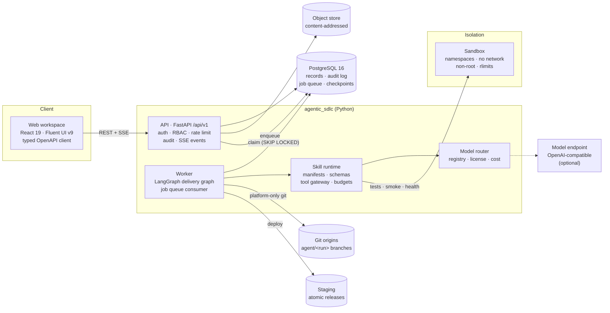
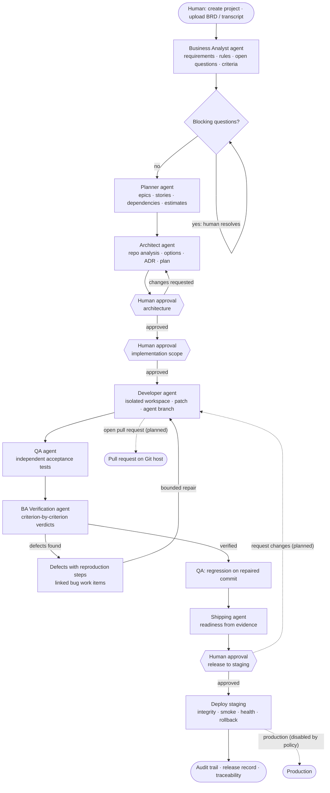
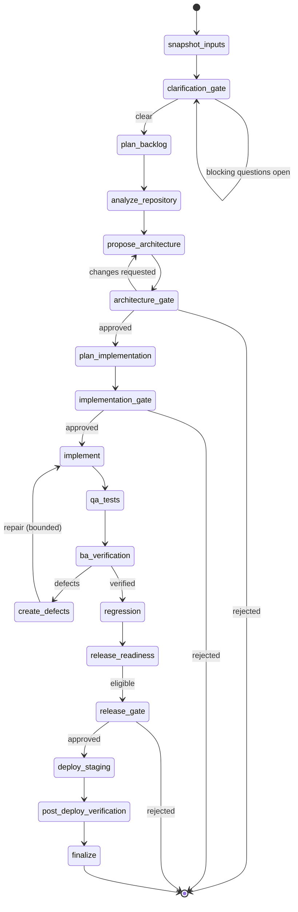
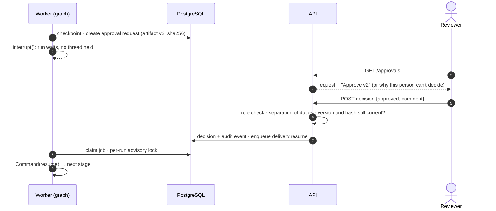
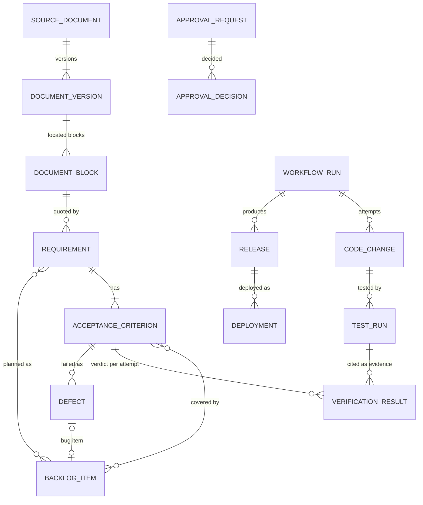
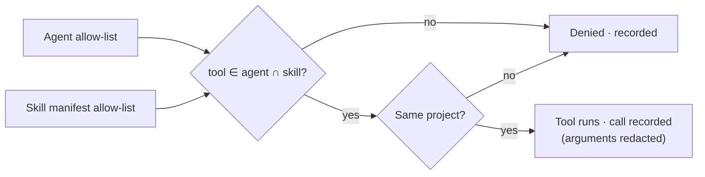
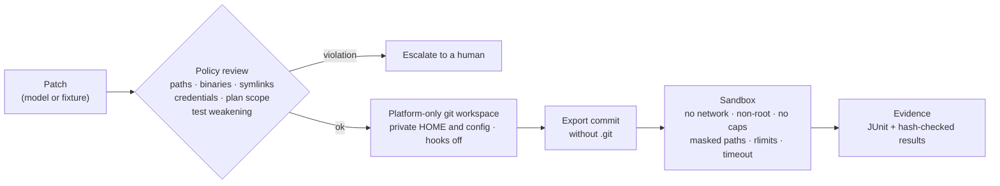
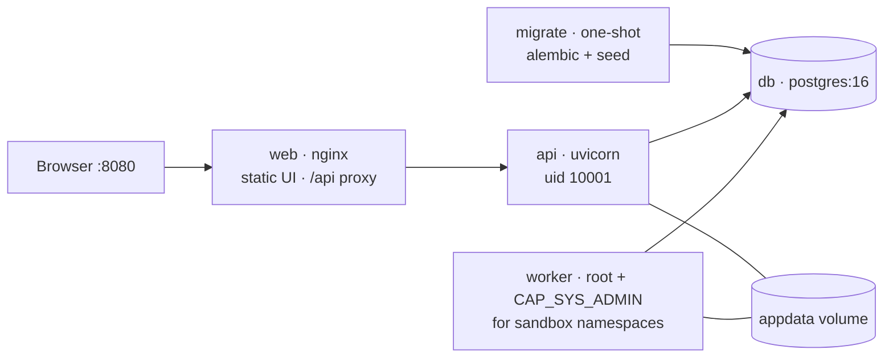
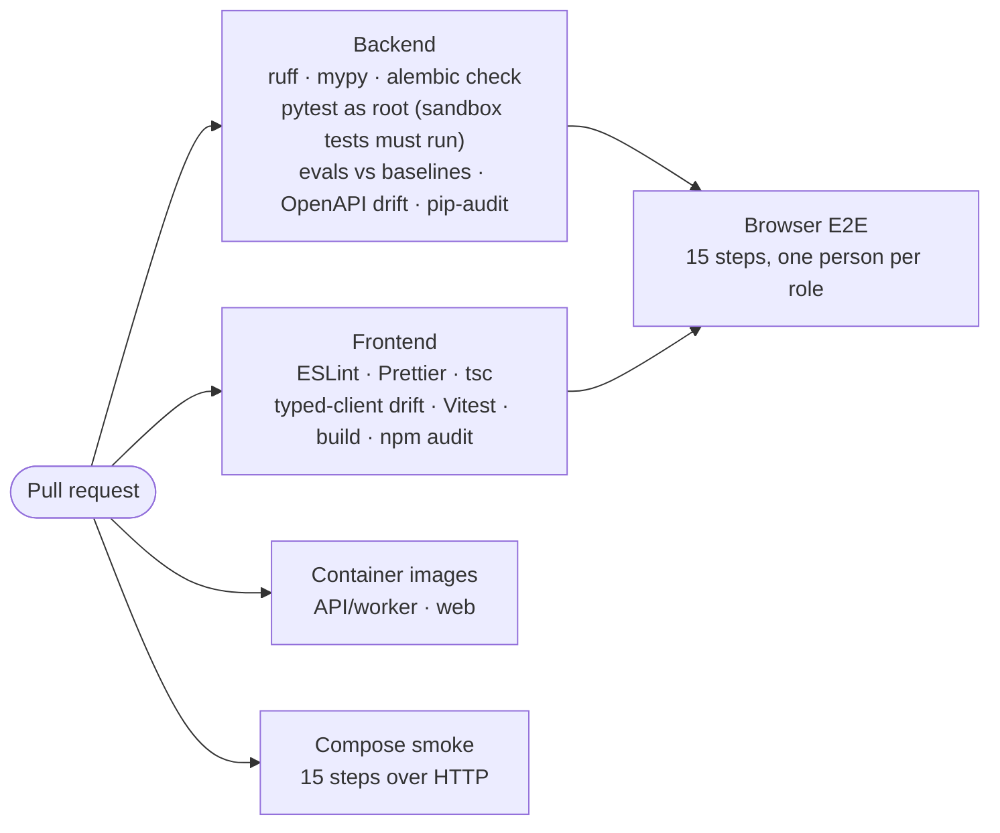

<div align="center">

# Agentic SDLC Workspace

**From a business requirements document to a verified, approved staging release, carried out by
specialized agents with humans in charge of every consequential decision.**

[](https://github.com/joyrana/agentic-sdlc-workspace/actions/workflows/ci.yml)


<br>
[](https://github.com/astral-sh/ruff)


[](https://www.conventionalcommits.org)
[](docs/decisions)

[What works](#what-works-today) · [Architecture](#architecture) · [Lifecycle](#delivery-lifecycle) ·
[Security](#security-model) · [Quick start](#quick-start) · [Quality](#quality-gates) ·
[ADRs](#architecture-decision-records) · [Roadmap](#roadmap)

</div>


## Principles

- **Skill-driven, workflow-backed.** Agents run versioned skills with JSON-schema contracts
  inside a durable LangGraph workflow that survives restarts.
- **Least privilege.** A tool call succeeds only if both the agent and the skill allow it, scoped
  to one project, and every call is recorded with redacted arguments.
- **Untrusted by default.** Documents, repository files, tool results and model output are data,
  never instructions. Generated code runs only in a sandbox with no network.
- **Evidence over assertion.** Acceptance is decided from independent test evidence for the exact
  commit. Criteria without a test are reported as *unverifiable*, never as passed.
- **Humans decide.** Architecture, implementation scope and releases need a person in the right
  role, bound to the exact version they reviewed. Agents cannot approve anything.
- **Honest labels.** Every result records whether it came from a model, rules, a mock or a scripted
  fixture, and the UI shows it.

## What works today

The first vertical slice runs end to end, in CI, through the browser and through the Docker
Compose stack:

| # | Step | Who |
|---|---|---|
| 1 | Create a project and staff it with people in roles | Owner |
| 2 | Upload a BRD (`.docx`) or meeting transcript | Engineer |
| 3 | Extract requirements, rules, open questions and acceptance criteria, each quoting its source passage | Business Analyst agent |
| 4 | Review and edit acceptance criteria (versioned) | Reviewer |
| 5 | Plan an epic with dependent stories, estimates and milestones | Planner agent |
| 6 | Inspect the repository, compare design options, write an ADR | Architect agent |
| 7 | Approve that exact architecture version | Reviewer |
| 8 | Change code in a disposable clone, commit to an agent branch, run developer tests in the sandbox | Developer agent |
| 9 | Run an independent acceptance suite against the exact commit | QA agent |
| 10 | Map each criterion to evidence; failures become reproducible defects; bounded repair | BA Verification and QA agents |
| 11 | Re-run regression on the repaired commit | QA agent |
| 12 | Compute release readiness from recorded evidence only | Shipping agent |
| 13 | Approve the release to staging | Release approver (only) |
| 14 | Deploy atomically with integrity, smoke and health checks, rolling back on failure | Shipping agent |
| 15 | Record everything in an immutable audit trail; production stays disabled by policy | Platform |

> [!IMPORTANT]
> **What is real and what is not.** The build environment has no GPU, so **no model inference
> runs here**. Each skill has a deterministic rule-based strategy, and the model path is
> implemented behind a provider-neutral interface (an OpenAI-compatible adapter, e.g. vLLM serving
> Qwen) and tested against a mock. The Developer agent's changes to the sample repository come
> from a **scripted fixture**: two recorded patches, the first with a deliberate off-by-one defect.
> Everything around them is real: the sandbox, git, the test runs, the defect, the repair loop, the
> release and the deployment. See the [validation report](docs/validation-report.md).

## Architecture

A modular monolith: one Python package serves the API and runs workflows in a separate worker.
Generated code never runs in either process ([ADR-0001](docs/decisions/0001-modular-monolith.md)).



<details>
<summary><b>Module map</b></summary>

| Module | Responsibility |
|---|---|
| `core` | settings, database, hashing, errors, structured logging with redaction, tracing, storage, hardened git environment |
| `auth` | token authentication, principals, role → permission policy (deny by default) |
| `audit`, `events` | immutable audit log (a DB trigger forbids UPDATE/DELETE); typed events and SSE |
| `projects`, `documents`, `requirements`, `backlog` | domain services for each step of discovery and planning |
| `skills`, `skills_impl` | manifest contract, registry, runtime, tool gateway, skill implementations |
| `models` | model registry, providers, router, token accounting |
| `architecture`, `approvals` | proposals, ADRs, plans; version-bound approval requests and decisions |
| `execution` | sandbox backends, git workspaces, test runner, coding agents |
| `releases` | readiness policy, artifacts, deployment adapters, rollback |
| `workflows` | job queue, worker, intake and delivery graphs |
| `evals` | offline evaluation suites and baseline gate |

</details>

## Delivery lifecycle

### Agents and hand-offs

Solid arrows are implemented; dashed arrows are planned (see [Roadmap](#roadmap)).



### Workflow states

The delivery run is one LangGraph graph with Postgres checkpoints, so it resumes after a crash or
restart. Any stage can **escalate**, which stops the run with a recorded reason for a human
([ADR-0002](docs/decisions/0002-postgres-job-queue-and-checkpoints.md)).



### Approval gates

Approvals bind to the artifact's version and content hash. Editing the artifact makes a pending
request stale, and agents and authors cannot approve their own work.



<details>
<summary><b>Traceability model</b></summary>

Every artifact links back to the passage it came from and forward to the evidence that verifies it.



</details>

## Agents, skills and tools

| Agent | Skills | Tools it may call | Deliverable |
|---|---|---|---|
| Business Analyst | `brd-analysis`, `transcript-analysis` | `documents.read` | Requirements with source references, open questions, criteria |
| Planner | `backlog-decomposition`, `effort-estimation`, `dependency-analysis` | `requirements.read`, `backlog.read` | Backlog, dependency graph, milestones, estimates |
| Architect | `repository-exploration`, `architecture-design`, `adr-generation`, `implementation-planning` | `repo.read`, `requirements.read`, `backlog.read` | Options, ADR, implementation plan |
| Developer | `code-generation` | `repo.read`, `repo.workspace`, `sandbox.exec`, `fixtures.read` | Reviewed change on `agent/<run>` |
| BA Verification | `acceptance-verification` | `requirements.read`, `evidence.read` | Per-criterion verdicts |
| QA | `regression-testing`, `bug-triage` | `sandbox.exec`, `repo.workspace`, `evidence.read`, `requirements.read` | Test runs, defects |
| Shipping | `release-readiness`, `deployment-validation` | `evidence.read`, `release.read`, `sandbox.exec` | Release record, deployment evidence |



Skills are YAML manifests in [`skills/`](skills), loaded only from the repository, with
schema-validated inputs and outputs, budgets, retries and evaluation criteria. A changed manifest
must bump its version. See the [authoring guide](docs/skills/authoring.md) and
[ADR-0003](docs/decisions/0003-skill-strategies-and-honest-labeling.md).

## Security model

Generated code takes one path, and the platform never executes it:



The [threat model](docs/security/threat-model.md) covers 19 threats with their controls and
verification status, plus the residual risks. Highlights:

- Approvals are human-only, role-checked and bound to content hashes; production is disabled by default.
- Uploads are checked against size limits, zip bombs and entity expansion; injected instructions in documents are flagged, never followed.
- The sandbox refuses to run with an unprotected toolchain; repository content cannot configure platform git.
- The audit log is immutable at the database level; logs and tool arguments are redacted.

## Quick start

### Docker Compose

```bash
docker compose up --build
open http://localhost:8080                                         # sign in with a token below
python3 scripts/smoke_slice.py --base-url http://localhost:8080    # optional: all 15 steps over HTTP
```



### Local development

Requires Linux, Python 3.12+, Node 22+, PostgreSQL 16, `git` and `unshare` (util-linux).

```bash
make setup                         # Python venv + npm install
sudo make sandbox-toolchain        # root-owned sandbox interpreter + sandbox user (uid 64000)
createdb sdlc && createdb sdlc_test
cp .env.example services/api/.env
make migrate seed
make api                           # http://127.0.0.1:8000  (API docs at /api/docs)
sudo -E make worker                # root, for the namespace sandbox
make web                           # http://localhost:5173
```

<details>
<summary><b>Development sign-in tokens</b> (refused when <code>APP_ENV=production</code>)</summary>

| Token | Person | Role in the demo |
|---|---|---|
| `dev_owner` | Olu Owner | project owner; approves implementation scope |
| `dev_engineer` | Eni Engineer | uploads sources, starts runs |
| `dev_reviewer` | Rae Reviewer | approves architecture |
| `dev_qa` | Quinn QA | reviews test evidence and defects |
| `dev_approver` | Ari Approver | release approver (staging) |
| `dev_auditor` | Aud Auditor | read-only audit access |
| `dev_admin` | Ada Admin | platform admin (reads, cannot approve) |

**Demo:** sign in as the owner, create a project, add people under **Settings**, register the
sample repository `sample-task-service`, upload `samples/documents/task-title-validation-brd.docx`
under **Sources**, and start a run from **Agent activity**. Approvals appear for the right person.

</details>

<details>
<summary><b>Connecting a model</b></summary>

Set `MODEL_ENDPOINT_URL` (and `MODEL_ENDPOINT_API_KEY` if needed) to an OpenAI-compatible endpoint,
for example vLLM serving `Qwen/Qwen2.5-7B-Instruct`. Models are declared in
`services/api/src/agentic_sdlc/config/models.yaml` with license, context window, capabilities and
price. The router filters by task, capability, context, privacy, availability and budget, and can
require a verified license. Licenses stay marked unverified until checked against the model card.

</details>

## Quality gates

Every pull request runs the full pipeline:



| Layer | Where |
|---|---|
| Unit, integration, contract, workflow, security, end-to-end | `services/api/tests` (real PostgreSQL; no SQLite fallback) |
| Offline evaluations with committed baselines | `evals/`, `python -m agentic_sdlc.evals.run --all` |
| Frontend unit | `apps/web/src/**/*.test.tsx` |
| Browser E2E | `apps/web/e2e` (Playwright) |
| Deployment smoke | `scripts/smoke_slice.py` |

```bash
make check     # ruff, mypy, ESLint, Prettier, tsc, pytest, Vitest
make evals     # evaluation suites against evals/baselines.json
```

Current results are in the [validation report](docs/validation-report.md); the strategy is in
[evaluation-strategy.md](docs/testing/evaluation-strategy.md).

## Architecture decision records

| ADR | Decision | Status |
|---|---|---|
| [0001](docs/decisions/0001-modular-monolith.md) | Modular monolith with a separate worker and sandbox boundary | Accepted |
| [0002](docs/decisions/0002-postgres-job-queue-and-checkpoints.md) | PostgreSQL for the job queue, event log and LangGraph checkpoints | Accepted |
| [0003](docs/decisions/0003-skill-strategies-and-honest-labeling.md) | Skill execution strategies and labeling of non-model output | Accepted |
| [0004](docs/decisions/0004-retrieval-without-pgvector.md) | Defer pgvector; structured locators and Postgres full-text search | Accepted |
| [0005](docs/decisions/0005-namespace-sandbox.md) | Sandbox backends: Linux namespaces (verified) and Docker (deployments) | Accepted |
| [0006](docs/decisions/0006-authentication.md) | Token authentication now, OIDC later; RBAC policy in the backend | Accepted |

New decisions go in `docs/decisions/NNNN-title.md` with context, decision, consequences and status.

## Roadmap

Known gaps, stated plainly ([full table](docs/implementation-plan.md#3a-gaps-against-the-phase-definitions)):

- [ ] Developer agent opens a pull request on the Git host (today: commits to `agent/<run>` in the platform's origin)
- [ ] Release gate "request changes" loops back to the Developer agent (today: rejection ends the run)
- [ ] Model-backed runs and model comparisons in the evaluation harness (needs a model endpoint)
- [ ] Contradiction detection across different nouns for the same subject (recall 0.5 today)
- [ ] SAST and dependency scanning of the target repository
- [ ] GitHub Actions deployment adapter exercised end to end; production path behind policy
- [ ] OIDC sign-in (ADR-0006); automated test for the Docker sandbox backend

## Repository layout

```
apps/web/                 React + Fluent UI workspace (Vite, TanStack Query, typed OpenAPI client)
services/api/             FastAPI app, worker, skills runtime, migrations, tests
skills/                   skill manifests (YAML), loaded only from this directory
samples/                  sample BRD, transcript, fixture repository, scripted patches
evals/                    labelled datasets and baselines for the offline evaluation suites
infrastructure/docker/    API/worker and web images
scripts/                  smoke test for a running deployment
docs/                     plan, architecture, threat model, testing, ADRs, validation report
```

## Contributing

- One pull request per milestone, never direct pushes to `main`.
- [Conventional Commits](https://www.conventionalcommits.org) (`feat:`, `fix:`, `docs:`, `ci:`).
- `make check` and `make evals` must pass; baselines are raised in a reviewed change, never lowered to pass.
- Significant decisions get an ADR; new skills follow the [authoring guide](docs/skills/authoring.md).

## License

No license file has been chosen yet; that is the repository owner's decision (the package metadata
currently declares Apache-2.0). Models, datasets and tools you connect keep their own licenses.
