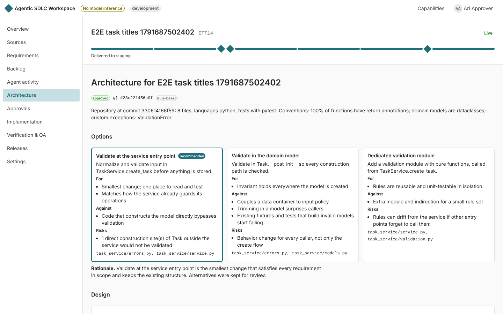
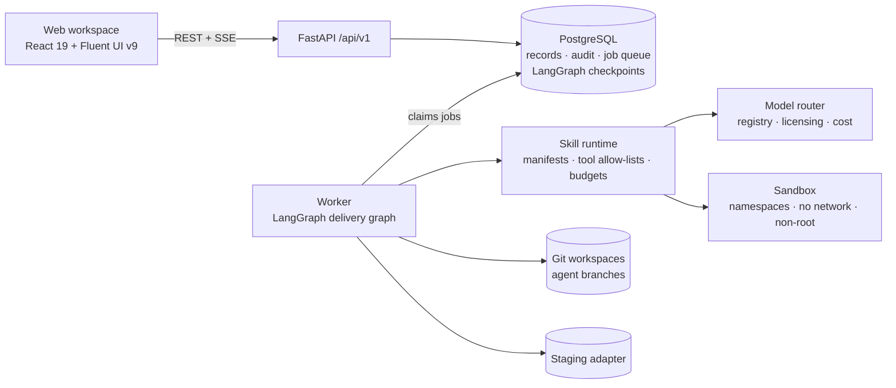

# Agentic SDLC Workspace

A skill-based workspace that takes business requirements through planning, architecture,
implementation, independent verification, human approval and controlled deployment. The backend
is workflow-driven, agents are specialized, tools are permissioned, every result is traceable to
its evidence, and humans hold authority over every consequential decision.



## What works today

The first vertical slice runs end to end, in CI, through the browser and through the
Docker Compose stack:

1. Create a project and staff it with people in specific roles.
2. Upload a BRD (`.docx`) or meeting transcript.
3. The **Business Analyst** agent extracts requirements, business rules, open questions and
   acceptance criteria. Every item quotes the passage it came from.
4. Reviewers edit acceptance criteria (versioned, with revisions).
5. The **Planner** agent builds an epic with dependent stories, estimates and milestones.
6. The **Architect** agent inspects the sample repository, compares design options and writes an ADR.
7. A human reviewer approves that exact version (approvals are bound to a content hash).
8. The **Developer** agent changes code in a disposable clone, commits to an agent branch and runs
   the developer tests inside a sandbox with no network.
9. The **QA** agent runs an independent acceptance suite against the exact commit.
10. The **BA Verification** agent maps each criterion to test evidence; a failing criterion becomes a
    reproducible defect, and the repair loop runs (bounded).
11. Regression runs on the repaired commit.
12. The **Shipping** agent computes release readiness from recorded evidence only.
13. A release approver approves deployment to staging (no one else can).
14. Staging deploys atomically, with smoke and health checks and automatic rollback.
15. Every step is in the audit trail; production stays disabled by policy.

### What is real and what is not

There is no GPU in the build environment, so **no model inference runs here**. Each skill has a
deterministic, rule-based strategy, and the model-backed path is implemented against a
provider-neutral interface (an OpenAI-compatible adapter for vLLM serving Qwen). Every result
records which strategy produced it, and the UI labels it: *Rule-based*, *Model*, *Mock model* or
*Scripted fixture*. The Developer agent's code changes for the sample repository come from a
**scripted fixture** (two recorded patches, the first with a deliberate off-by-one defect) and are
labeled that way everywhere. Everything around them is real: the sandbox, git, the test runs, the
defect, the repair loop, the release and the deployment.

See [docs/implementation-plan.md](docs/implementation-plan.md) for phase status and
[docs/validation-report.md](docs/validation-report.md) for what was verified and how.

## Architecture



One Python package (`services/api/src/agentic_sdlc`) serves the API and runs workflows in a
separate worker. Generated code never runs in either process. Details:
[system overview](docs/architecture/system-overview.md),
[agent workflows](docs/architecture/agent-workflows.md),
[threat model](docs/security/threat-model.md), [decisions](docs/decisions/).

## Run it

### Docker Compose (simplest)

```bash
docker compose up --build
python3 scripts/smoke_slice.py --base-url http://localhost:8080   # optional: drives all 15 steps
```

Open <http://localhost:8080> and sign in with a development token (below). The worker container
gets `CAP_SYS_ADMIN` so it can create sandbox namespaces; the code it runs inside them does not.

### Local development

Requirements: Linux, Python 3.12+, Node 22+, PostgreSQL 16, `git`, `unshare` (util-linux).
Running untrusted code needs the worker to run as root (or with `CAP_SYS_ADMIN`).

```bash
make setup                         # Python venv + npm install
sudo make sandbox-toolchain        # /opt/asw-sandbox interpreter + the sandbox user (uid 64000)
createdb sdlc && createdb sdlc_test
cp .env.example services/api/.env  # adjust DATABASE_URL if needed
make migrate seed
make api                           # http://127.0.0.1:8000
sudo -E make worker                # root for the namespace sandbox
make web                           # http://localhost:5173
```

Development sign-in tokens (refused when `APP_ENV=production`):

| Token | Person | Typical role in the demo |
|---|---|---|
| `dev_owner` | Olu Owner | project owner, approves implementation scope |
| `dev_engineer` | Eni Engineer | uploads sources, starts runs |
| `dev_reviewer` | Rae Reviewer | approves architecture |
| `dev_qa` | Quinn QA | reviews test evidence and defects |
| `dev_approver` | Ari Approver | release approver (staging) |
| `dev_auditor` | Aud Auditor | read-only audit access |
| `dev_admin` | Ada Admin | platform admin (reads, cannot approve) |

Demo: sign in as the owner, create a project, add the other people under **Settings**, register
the sample repository `sample-task-service`, then upload
`samples/documents/task-title-validation-brd.docx` under **Sources** and start a delivery run
from **Agent activity**. Approvals appear under **Approvals** for the right person.

### Connecting a model

Set `MODEL_ENDPOINT_URL` (and `MODEL_ENDPOINT_API_KEY` if needed) to an OpenAI-compatible
endpoint, for example vLLM serving `Qwen/Qwen2.5-7B-Instruct`. Models are declared in
`services/api/src/agentic_sdlc/config/models.yaml` with license, context window, task
capabilities and price. The router filters by task, capability, context window, privacy policy,
availability and budget, and can require a verified license; licenses stay marked unverified
until someone checks them against the model card.

## Tests and evaluations

```bash
make check     # ruff, mypy, ESLint, Prettier, tsc, pytest, Vitest
               # (sandbox tests run only when pytest runs as root; CI runs them as root)
make evals     # offline evaluation suites against committed baselines
cd apps/web && npx playwright test   # browser E2E (needs API + worker + seeded DB)
```

CI (`.github/workflows/ci.yml`) runs all of the above, plus the OpenAPI and typed-client drift
checks, dependency audits, container image builds, and the Compose smoke test.

## Repository layout

```
apps/web/                 React + Fluent UI workspace (Vite, TanStack Query, typed OpenAPI client)
services/api/             FastAPI app, worker, skills runtime, migrations, tests
skills/                   skill manifests (YAML), loaded only from this directory
samples/                  sample BRD, transcript, fixture repository, scripted patches
evals/                    labelled datasets and baselines for the offline evaluation suites
infrastructure/docker/    API/worker and web images
scripts/                  smoke test for a running deployment
docs/                     plan, architecture, threat model, testing strategy, ADRs, reports
```

## Contributing a skill

See [docs/skills/authoring.md](docs/skills/authoring.md).

## License

No license file has been chosen yet; that is the repository owner's decision (the package
metadata currently declares Apache-2.0). Models, datasets and tools you connect keep their own
licenses.
