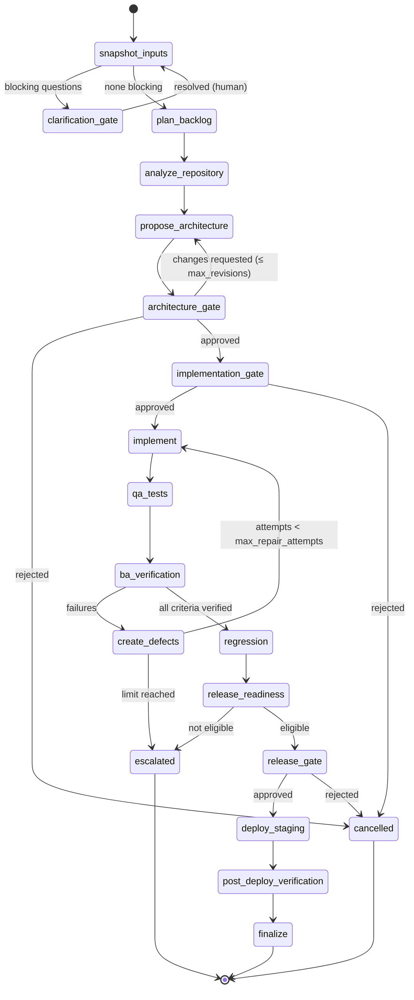

# Agents and Workflows

## Agents

Agents are **service principals** (`users.is_service_account = true`) with a declared skill
set and tool allow-list. Service principals hold no project roles and therefore can never
satisfy an approval policy: approval requires a human principal with the gate's role.

| Agent | Skills (first slice) | Tools allowed |
|---|---|---|
| Business Analyst | `brd-analysis`, `transcript-analysis`, `acceptance-criteria-generation` | `documents.read` |
| Planner | `backlog-decomposition`, `effort-estimation`, `dependency-analysis` | `requirements.read`, `models.estimate` |
| Architect | `repository-exploration`, `architecture-design`, `adr-generation` | `repo.read` |
| Developer | `code-generation` | `repo.workspace`, `sandbox.exec` |
| BA Verifier | `acceptance-verification` | `requirements.read`, `evidence.read` |
| QA | `regression-testing`, `bug-triage` | `sandbox.exec`, `evidence.read` |
| Shipping | `release-readiness`, `deployment-validation` | `release.read`, `deploy.staging` |

The BA Verifier reuses the BA capabilities but runs as a separate stage, reading only
recorded evidence (test runs, code changes), never the developer's self-reported summary.

## Delivery graph (v1)



### Gates

| Gate | Artifact bound | Required role |
|---|---|---|
| `requirements_clarification` | open questions marked blocking | `project_owner` |
| `architecture` | architecture proposal revision (content hash) | `reviewer` or `project_owner` |
| `implementation_scope` | implementation plan revision (content hash) | `project_owner` |
| `release_staging` | release record (artifact sha256 + readiness hash) | `release_approver` |
| `release_production` | release record | `release_approver`; **disabled by policy by default** |

A gate node calls `interrupt()` with the approval request id. The run is `awaiting_approval`.
`POST /approvals/{id}/decision` checks: principal is human, holds the role in that project,
request is `pending`, and the artifact's current content hash equals the hash the request was
created for. If the hash differs the request becomes `stale` and the decision is refused
(HTTP 409). A valid decision is recorded and a `resume` job is enqueued with a dedup key of the
decision id. The gate node, on resume, re-reads the decision from the database; it never
trusts the resume payload alone.

### Bounds and budgets

Every run carries limits (configurable per project): `max_repair_attempts` (default 3),
`max_architecture_revisions` (3), `max_model_calls` (200), `max_tokens` (2,000,000),
`max_cost_usd` (25.0), `max_wall_clock_s` (3,600). Each node checks them before work; any
breach moves the run to `escalated` with the reason recorded.

### Idempotency

Nodes may re-execute after a crash (LangGraph resumes from the last checkpoint). Every node
side effect is keyed: e.g. `code_change(run_id, backlog_item_id, attempt)` and
`test_run(run_id, suite, attempt)` are unique; nodes use get-or-create. Jobs carry dedup keys
(`run:{id}:start`, `decision:{id}`), so duplicate submissions are no-ops.

## Intake graph

`normalize_document → analyze (brd-analysis | transcript-analysis) → persist_extraction →
emit_events`. No interrupts; failures mark the document version `failed` with warnings.

## Event envelope

```json
{
  "event_id": "uuid",
  "seq": 1042,
  "type": "workflow.stage_completed",
  "schema_version": 1,
  "project_id": "uuid",
  "run_id": "uuid | null",
  "ts": "2026-10-10T14:31:00Z",
  "correlation_id": "uuid",
  "causation_id": "uuid | null",
  "artifact_refs": [{"type": "architecture_proposal", "id": "uuid", "version": 2}],
  "payload": {}
}
```

Clients resume with `Last-Event-ID` (= `seq`) and deduplicate by `event_id`.
